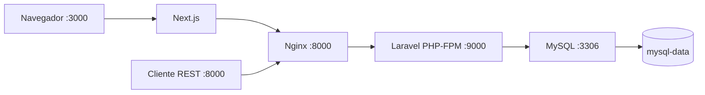

# Ingeniería de imágenes eficientes

Aplicación de tareas con Next.js 16 (App Router), API REST Laravel 12 / PHP 8.2, Nginx y MySQL 8.0. Demuestra builds multi-stage, caché de capas y persistencia.

**Origen:** el repositorio solo contenía un README. Se creó una aplicación de referencia sobre la plantilla oficial MIT de Laravel. No son aplicaciones previas del bootcamp: para cumplir ese punto de la consigna deben incorporarse los proyectos originales del estudiante.

## Arquitectura



Tres servicios lógicos en cuatro contenedores: Nginx y FPM separados para mantener un proceso principal por contenedor. MySQL y FPM no publican puertos al host. Los puertos públicos se vinculan a localhost; para despliegue remoto configura un proxy de entrada con TLS.

## Ejecutar

Requisitos: Docker Engine y Compose v2, Internet en la primera construcción. No requiere PHP, Composer ni Node en el host.

Desde PowerShell en la raíz:

```powershell
pwsh -File scripts/setup.ps1
docker compose up --build -d
docker compose ps
pwsh -File scripts/smoke.ps1
```

Si no tienes pwsh usa `powershell -File`. El script crea `.env` con contraseñas y APP_KEY aleatorias sin sobrescribir archivos existentes. Alternativa: copiar `.env.example` a `.env` y completar claves. APP_KEY es `base64:` seguido de 32 bytes aleatorios codificados en base64. En Linux, generar cada secreto con `openssl rand -base64 32`.

Abrir [frontend](http://localhost:3000) y [salud de API y MySQL](http://localhost:8000/api/health). Inicialmente no hay tareas. Para crear una y verla al recargar:

```powershell
Invoke-RestMethod http://localhost:8000/api/tasks -Method Post -ContentType application/json -Body '{"title":"Entregar actividad Docker"}'
```

API: GET/POST `/api/tasks`, GET/PATCH/PUT/DELETE `/api/tasks/{id}`. Respuestas: 201 al crear, 204 al borrar, 404 para IDs ausentes y 422 para datos inválidos con `Accept: application/json`. Es una demostración sin autenticación; añadir autenticación y autorización antes de exponerla públicamente.

## Decisiones técnicas

| Imagen | Etapas y optimizaciones |
| --- | --- |
| Next.js | dependencies instala con npm ci copiando primero los manifiestos; build ejecuta next build; production-dependencies instala sin desarrollo; runtime recibe .next, node_modules y package.json y ejecuta next start como usuario node. Node 22 Alpine es compatible con Next 16 y posterior al Node 20 recomendado. No se copia código fuente ni caché npm a runtime. |
| Laravel | php-base instala pdo_mysql, mbstring, xml y opcache; elimina compiladores en la misma capa. OpenSSL, tokenizer, ctype y JSON están habilitados por PHP oficial. dependencies instala Composer sin desarrollo y genera autoload optimizado. Solo vendor/ se copia de esa etapa al runtime, junto con carpetas explícitas del código de aplicación. Composer queda fuera. FPM usa www-data. |
| Nginx | Target separado basado en nginx-unprivileged Alpine. Copia solo public/ y configuración. Escucha en 8000 sin root; solo index.php se envía a FPM. |
| MySQL | Imagen oficial mysql:8.0, configurada mediante las cuatro variables MYSQL requeridas y volumen en /var/lib/mysql. No necesita Dockerfile personalizado. |

Los .dockerignore excluyen secretos, dependencias locales y cachés. Los lockfiles fijan dependencias transitivas; Composer resuelve para PHP 8.2.30. Los tags base reciben parches: para reproducibilidad binaria estricta fija digests SHA256 verificados del registro.

Las capas de dependencias solo se invalidan si cambian manifiestos o lockfiles. El entrypoint Laravel genera cachés con las variables de ejecución y aplica migraciones antes de FPM. MySQL tiene healthcheck autenticado; Nginx verifica Laravel y su conexión con MySQL, y Next espera al proxy saludable. Las migraciones automáticas sirven para esta instancia única; con réplicas deben ejecutarse como un trabajo de release exclusivo. APP_DEBUG está desactivado y los logs van a stderr. No regenerar APP_KEY al reiniciar.

## Operación y validación

```powershell
docker compose logs --tail=100
docker compose exec backend php artisan migrate:status
docker compose exec backend php -m
docker compose images
docker compose build
docker compose down
docker compose up -d
```

La segunda construcción permite observar capas CACHED. Usa docker compose images para tamaños reales y docker history para inspeccionar capas. No se afirma un porcentaje de reducción sin medir una imagen anterior equivalente.

El volumen mantiene tareas tras down/up. `docker compose down -v` elimina los datos; usar solo para reiniciar deliberadamente la demostración. Cambiar MYSQL_PASSWORD en .env no cambia usuarios de un volumen existente: rotar con SQL y coordinar la configuración.

scripts/smoke.ps1 prueba salud, creación, actualización, validación 422 y renderizado de datos MySQL en Next.js; elimina su tarea de prueba. Usa los puertos predeterminados: ajustar URLs si se cambian FRONTEND_PORT o API_PORT.

## Referencias

Los resultados reales de construcción, integración, persistencia y tamaños están en [VALIDACION.md](VALIDACION.md).

- [Next.js 16](https://nextjs.org/blog/next-16)
- [Despliegue Laravel 12](https://laravel.com/docs/12.x/deployment)
- [Docker multi-stage](https://docs.docker.com/build/building/multi-stage/)
- [MySQL oficial](https://hub.docker.com/_/mysql)
